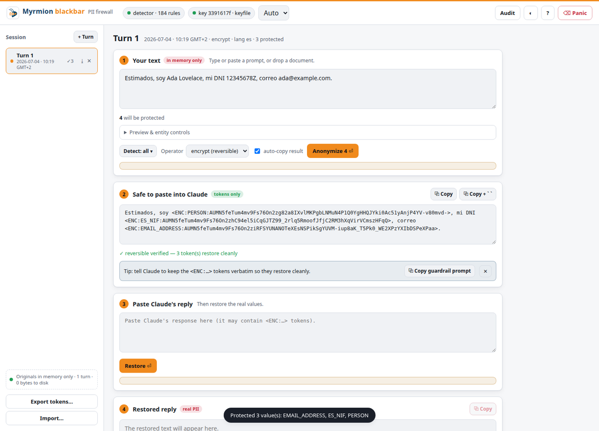

<p align="center">
  
</p>

<h1 align="center">Myrmion blackbar</h1>

<p align="center"><i>Privacy guard for Claude — local PII / PHI / financial redaction powered by Microsoft Presidio</i></p>

<p align="center">
  <a href="#license"></a>
  
  
  
  
</p>

<p align="center">
  <b>Myrmion blackbar puts a censor bar over your personal data before it ever reaches the AI.</b>
</p>

---

## Table of contents

**Start here (everyone)**
1. [What is blackbar, in plain words](#1-what-is-blackbar-in-plain-words)
2. [Why you might need it](#2-why-you-might-need-it)
3. [What it protects](#3-what-it-protects)
4. [How it works (the simple picture)](#4-how-it-works-the-simple-picture)
5. [Which version is for me?](#5-which-version-is-for-me)
6. [Get started in 3 steps](#6-get-started-in-3-steps)

**Set up your version**
7. [Claude Code](#7-claude-code-automatic-protection)
8. [Claude Desktop](#8-claude-desktop-on-demand-protection)
   - [The web app (copy/paste firewall)](#the-web-app-local-copypaste-firewall)
9. [Transparent proxy](#9-transparent-proxy-advanced-api-key)

**Understand & troubleshoot**
10. [Reversible anonymization, explained simply](#10-reversible-anonymization-explained-simply)
11. [Frequently asked questions](#11-frequently-asked-questions)
12. [Troubleshooting](#12-troubleshooting)
13. [Glossary (plain-language)](#13-glossary-plain-language)
14. [Good to know (limits & honesty)](#14-good-to-know-limits--honesty)

**For technical users**
15. [Reference (commands, settings, structure)](#15-reference-for-technical-users)
    - [Command & interface reference](#command--interface-reference) (CLI · slash · MCP)
16. [License](#license)

---

## 1. What is blackbar, in plain words

When you use an AI assistant like **Claude**, everything you type or paste — and every
file or web page the AI reads for you — is **sent off your computer** to be processed. If
that text contains personal information (a customer's name, an email, a national ID, a
medical diagnosis, a bank account), it leaves your control the moment it's sent.

**Myrmion blackbar** is a small guard that runs **on your own computer**. Think of it as the
black marker a clerk uses to censor a document before sharing it: it scans your text, **finds the
personal data, and blacks it out** (for example, turning `ada@example.com` into
`<EMAIL_ADDRESS>`) **before the AI sees it**.

The detection happens **entirely on your machine** — blackbar does not send your text to
any outside service to find the personal data. It uses an open-source engine from Microsoft
called **Presidio**.

You can make the change **permanent** (the original is gone) or **reversible** (blackbar
can put the real values back later, but only on your computer, with your secret key).

---

## 2. Why you might need it

- **Accidental leaks are easy.** A name in a spreadsheet, an email in a log file, an ID in a
  support ticket — it's simple to paste something sensitive without noticing.
- **The law cares.** Under the EU's **GDPR** and the new **EU AI Act**, you are responsible
  for protecting people's personal data. Feeding real customer or patient data into an AI
  can put you on the wrong side of those rules. blackbar lowers that risk by removing the
  data before it travels.
- **Subscriptions, too.** If you use Claude on a **Pro/Max subscription** (not a developer
  API key), blackbar still works — through the Claude Code plugin and a copy-paste helper —
  without touching your login.

> blackbar is a **safety net**, not a magic shield. It catches the large majority of common
> personal data, but no tool is perfect — keep a person in the loop for anything sensitive.

---

## 3. What it protects

In everyday terms, blackbar recognises things like:

- **Who someone is:** names, home/postal addresses, email addresses, phone numbers.
- **Online identifiers:** IP addresses, website links, device (MAC) addresses, dates.
- **Money:** credit-card numbers, bank account numbers (IBAN), bank codes (SWIFT/BIC),
  VAT/tax numbers, crypto wallet addresses.
- **Official IDs:** Spanish DNI/NIE, Portuguese NIF, German tax ID, Italian fiscal code,
  US Social Security numbers, passports.
- **Social security numbers:** Spain (NUSS), France (NIR), United States.
- **Health information:** medical record/insurance numbers, diagnosis codes (ICD‑10),
  medical license numbers.
- **Sensitive "special category" data (GDPR Art. 9):** mentions of someone's health,
  religion, political views, ethnic origin, sexual orientation, or trade-union membership.

It understands **six languages**: English, Spanish, French, German, Italian and Portuguese.

**What is active by default**

Everything above works **out of the box, with no configuration** — including the GDPR
Art. 9 special categories. The full list of entity types blackbar detects and can censor:

| Group | Entity types (always on) |
| --- | --- |
| Identity & contact | `PERSON` · `LOCATION` · `EMAIL_ADDRESS` · `PHONE_NUMBER` · `URL` · `IP_ADDRESS` · `MAC_ADDRESS` · `DATE_TIME` |
| Financial | `CREDIT_CARD` · `IBAN_CODE` · `SWIFT_BIC` · `EU_VAT` · `CRYPTO` |
| National & social-security IDs | `ES_NIF` · `ES_NIE` · `PT_NIF` · `DE_STEUER_ID` · `IT_FISCAL_CODE` · `US_SSN` · `PASSPORT_GENERIC` · `ES_SSN` · `FR_NIR_SSN` |
| Health / PHI | `MEDICAL_LICENSE` · `UK_NHS` · `HEALTH_RECORD` · `ICD10_CODE` |
| Special categories (Art. 9) | `HEALTH_CONDITION` · `RELIGIOUS_BELIEF` · `POLITICAL_OPINION` · `ETHNIC_ORIGIN` · `SEXUAL_ORIENTATION` · `TRADE_UNION` |

The **only** optional piece is the Layer 2 zero-shot classifier (for *paraphrased*
special-category data, e.g. "he's been feeling very low"); it is **off by default** and
enabled with `BLACKBAR_ENABLE_ZEROSHOT=1` (see §15). Every entity above can be transformed
with any operator (`replace` / `redact` / `mask` / `hash` / `encrypt`).

---

## 4. How it works (the simple picture)

```
        YOUR COMPUTER                                  THE AI (cloud)
  ┌────────────────────────────┐
  │  your text / files / logs  │
  │            │               │
  │            ▼               │
  │     ┌─────────────┐        │      only the safe,
  │     │  blackbar   │  ───►  │  ───►  censored text
  │     │ finds & hides│       │        leaves your machine
  │     │  personal    │       │
  │     │  data        │  ◄──  │  ◄───  the AI's reply
  │     └─────────────┘        │        (originals restored
  │   (Presidio runs here,     │         locally if reversible)
  │    nothing is sent out      │
  │    just to detect)         │
  └────────────────────────────┘
```

There are two small pieces:

1. **The analyzer** — a local helper that holds the language models and finds the personal
   data. You start it once; it runs quietly in the background on your computer.
2. **The connector** — the part that plugs into Claude (a plugin, a desktop extension, or a
   proxy) and actually does the censoring at the right moment.

---

## 5. Which version is for me?

| If you use… | Choose | What you get |
| --- | --- | --- |
| **Claude Code** (terminal or VS Code) | [Claude Code plugin](#7-claude-code-automatic-protection) | **Automatic** — censors what the AI reads, plus on-demand commands |
| **Claude Desktop** (the app) | [Desktop extension](#8-claude-desktop-on-demand-protection) | **On-demand** — you ask "scan/anonymize this" |
| **Claude Desktop / claude.ai, by copy-paste** | [The web app](#the-web-app-local-copypaste-firewall) | A localhost page: paste → anonymize → copy into Claude → paste the reply → restore |
| **Claude Code with a developer API key** and you want it fully invisible | [Transparent proxy](#9-transparent-proxy-advanced-api-key) | You type/read normal text; the AI only sees censored text |
| **Any website/app** (claude.ai, browser extension, Office) | the copy-paste helper (works on subscriptions) | Censor on copy, restore on paste — see [§10](#10-reversible-anonymization-explained-simply) |

Not sure? If you mostly work in **Claude Code**, pick that — it's the most automatic.

---

## 6. Get started in 3 steps

Every version needs the same first piece: **the analyzer** running on your computer. You
only do this once.

### Step 1 — Download blackbar

```bash
git clone https://github.com/e2its/myrmion-blackbar-pii-guard.git
cd myrmion-blackbar-pii-guard
```

### Step 2 — Start the analyzer (no Docker required)

```bash
cd plugins/blackbar/presidio-native
./setup.sh     # first time only: prepares everything and downloads the models (a few minutes)
./run.sh       # starts the analyzer — leave this window open
```

> Prefer Docker? The image is **published**, so just run
> `docker compose -f plugins/blackbar/docker-compose.yml up -d` — it pulls
> `e2its/presidio-analyzer-multilang:latest` (or `:lg` for the large models). Build it
> yourself only to customise languages/size. Both behave identically.

### Step 3 — Check it's working

Open a **second** terminal window and run:

```bash
curl http://localhost:5002/health
```

You should see something like `{"status":"ok", ...}`. That's it — now set up your version
below. 🎉

*(Brand-new to the terminal? See the [extra-detailed walkthrough](#a-completely-new-to-the-terminal) at the end.)*

---

## 7. Claude Code (automatic protection)

**Best for:** people working in the Claude Code terminal or the VS Code extension.

### What you get

- **Automatic censoring** of anything the AI reads for you (files, command output, web
  pages) — *the file on your disk and what your commands actually do are never changed*,
  only what the AI sees.
- A **warning** if your own prompt contains personal data.
- A **prompt before** any web request that would send personal data out.
- **Commands** you can run yourself: `/blackbar:scan`, `/blackbar:anonymize`,
  `/blackbar:decrypt`.

### Install

1. Make sure the analyzer is running (steps in §6).
2. In Claude Code, run:
   ```
   /plugin marketplace add e2its/myrmion-blackbar-pii-guard
   /plugin install blackbar@e2its
   ```

That's it — protection starts immediately.

### How to use it

- **Just work normally.** Censoring of what the AI reads happens by itself.
- **Check a piece of text:** `/blackbar:scan "Contact Ada at ada@example.com"`
- **Clean a piece of text:** `/blackbar:anonymize "my DNI is 12345678Z"`
- **Restore reversible tokens:** `/blackbar:decrypt "...<ENC:…> ..."`

### Examples (what goes in → what comes out)

These are **real, verified** outputs. The slash commands call the tools under the hood; the
full per-command reference (arguments, raw output) is in [§15](#command--interface-reference).

**Censor — replace (default style)**
```
in : me llamo Ada Lovelace y mi DNI es 12345678Z      (Spanish)
out: me llamo <PERSON> y mi DNI es <ES_NIF>
```

**Censor — mask / hash**
```
mask: card 4111 1111 1111 1111   →  card ***************1111
hash: contact ada@example.com    →  contact <EMAIL_ADDRESS:b5fc85e557>
```
(`mask` blanks the whole value keeping the last 4 characters; `hash` is a short
deterministic digest of the original.)

**Special-category data — on by default (Art. 9)**
```
in : diabetes tipo 2 y es musulmán
out: <HEALTH_CONDITION> tipo 2 y es <RELIGIOUS_BELIEF>
```

**Reversible — encrypt now, restore later (needs a key)**
```
/blackbar:anonymize "patient Ada Lovelace, DNI 12345678Z" --operator encrypt
→ patient <ENC:PERSON:ATG_ypu6cphKx…> , DNI <ENC:ES_NIF:ATG_ypu6cphKx…>

/blackbar:decrypt "patient <ENC:PERSON:ATG_ypu6cphKx…> , DNI <ENC:ES_NIF:ATG_ypu6cphKx…>"
→ patient Ada Lovelace, DNI 12345678Z
```

*(Reversible mode needs a one-time key: run `bin/blackbar keygen`, or pass a key. More in
[§10](#10-reversible-anonymization-explained-simply).)*

---

## 8. Claude Desktop (on-demand protection)

**Best for:** people using the Claude Desktop app who want to clean text when they choose.

### What you get

Three tools you can ask Claude to use — **no automatic background censoring** (the desktop
app doesn't allow that for add-ons):

- *scan* — find personal data in a piece of text.
- *anonymize* — censor it (replace / mask / hash / redact / encrypt).
- *decrypt* — put reversible values back.

### Install

1. Make sure the analyzer is running (steps in §6).
2. In Claude Desktop: **Settings → Extensions → Install Extension…**, then choose the
   `blackbar.mcpb` file (or drag it onto the window). Approve it.

### How to use it & examples

Ask Claude in plain language; it calls the tools and shows the result:

```
You: "Scan this:  me llamo Ada Lovelace y mi DNI es 12345678Z"
→ PERSON (Ada Lovelace), ES_NIF (12345678Z)

You: "Anonymize it."
→ me llamo <PERSON> y mi DNI es <ES_NIF>
```

### Reversible on Desktop — you manage the key ⚠️

This is the key difference from Claude Code. The Desktop extension has **no key storage and
keeps no mapping or "pairs" file** — the `<ENC:…>` token is *self-contained* (the value is
encrypted inside it). So you must **give Claude a key when you encrypt and the same key when
you decrypt**, and keep that key yourself:

```
You: "Encrypt the PII in this with key swordfish-42:
      patient Ada Lovelace, DNI 12345678Z"
→ patient <ENC:PERSON:…>, DNI <ENC:ES_NIF:…>

You (later, even in a new chat): "Decrypt this with key swordfish-42:
      patient <ENC:PERSON:…>, DNI <ENC:ES_NIF:…>"
→ patient Ada Lovelace, DNI 12345678Z
```

If you lose the key, the values **cannot** be recovered — there is no stored copy anywhere.
(In Claude Code and the CLI you can instead save the key once with `bin/blackbar keygen` and
it's reused automatically; Desktop has no such file, by design.)

---

## The web app (local copy/paste firewall)

**Best for:** anyone using **Claude Desktop**, **claude.ai**, or any chat box who wants a
simple, friendly way to censor personal data by copy-and-paste — on a subscription, with no
API key, and no change to how you use Claude.

It's a small page that runs **only on your computer** (nothing is uploaded). Once it's set
up, day-to-day use is four steps:

1. **Paste** your prompt (or drag in a `.docx / .xlsx / .pdf / …` and it pulls out the text).
2. Click **Anonymize** — the personal data turns into reversible `<ENC:…>` tokens, and the
   safe version is copied to your clipboard for you.
3. **Paste** it into Claude Desktop and chat as normal.
4. **Paste** Claude's reply back into the app and click **Restore** — your real values return.



*The numbered cards match the four steps: ① your text → ② the safe, tokenized version (copied
for you) → ③ paste Claude's reply → ④ the restored text. On the **left**, the session list —
newest turn first, each stamped with its `date · time · timezone`; hover a turn to **archive**
or **delete** it. Along the **top**: the detector and key status, the language, and the
**Detect ▾** picker to choose which kinds of data to look for.*

### Easiest: one command

From the blackbar folder, run:

```bash
bin/blackbar-start
```

This starts the detector for you if it isn't already running — **the very first time it
prepares one automatically** (a few minutes, once) — waits until it's ready, and opens the app
in your browser at **http://127.0.0.1:8765**. Press **Ctrl-C** once to stop everything.

The only setup left: the first time, click the **key** button at the top of the page and
choose **Generate**. That's it.

### Manual start (two windows)

Prefer to run the pieces yourself (or you're on Windows without Git Bash)?

1. **The detector.** Do [§6](#6-get-started-in-3-steps) above once, and **leave that window
   open**. (Restoring text later doesn't need it, but anonymizing does.)
2. **The app.** In a **new** terminal, from the blackbar folder:
   ```bash
   python3 web/blackbar_web.py
   ```
   Your browser opens by itself at **http://127.0.0.1:8765**. *(On Windows, type `python`.)*
   Shortcuts that do the same: `bin/blackbar-web` or `bin/blackbar web`.
3. **A key.** The first time only, click the **key** button at the top → **Generate**. Keep it
   — without it, encrypted values can't be recovered.

### What the screen shows

- **Session list (left).** Every exchange is a **turn**, newest at the top, each stamped with
  its `date · time · timezone`. You can **archive** (↓) or **delete** (✕) turns.
- **Detect ▾.** Pick which kinds of data to look for in this turn (names, emails, IDs, health,
  and so on). Leave it on **all** unless you want to narrow it down.
- **Highlights & sensitivity.** Before you send, it shows exactly what it found so you can add
  or remove items, and a slider lets you make detection stricter or looser.
- **Restore diagnostics.** Because the app remembers the exact tokens it created, if Claude
  changes one and a value doesn't come back, it tells you *which* one — and gives you the
  correct token to paste again.
- **Panic** wipes everything from memory instantly.

### If something looks off

- **"detector offline" (red dot).** The analyzer window isn't running — start it again
  ([§6](#6-get-started-in-3-steps), Step 2). You can still **Restore**, just not **Anonymize**.
- **"no key".** Click the key button at the top → **Generate**.
- **A name isn't detected.** Open **Detect ▾** and make sure that type is ticked, nudge the
  **sensitivity** slider down a little, or select the text and mark it by hand.

Everything stays on your computer: your text and the key never leave your machine (the browser
only ever sees a short *fingerprint* of the key, never the key itself). It uses the **same
key** as the CLI/plugin/Desktop, so tokens are interchangeable. Technical details:
[web/README.md](web/README.md).

---

## 9. Transparent proxy (advanced, API key)

**Best for:** technical users running Claude Code with a **developer API key** who want the
protection to be completely invisible — you read and type normal text, and the AI only ever
receives censored text.

> ⚠️ **Not for Pro/Max subscriptions.** This method needs an API key from
> `console.anthropic.com`. Sending a subscription login through a proxy is against
> Anthropic's rules. On a subscription, use the Claude Code plugin (§7) and the copy-paste
> helper instead.

### Install & use

```bash
bin/blackbar keygen                              # one-time secret key
python3 proxy/blackbar_proxy.py                  # starts the proxy on port 8787

# in the window that launches Claude Code:
export ANTHROPIC_BASE_URL=http://localhost:8787
export ANTHROPIC_API_KEY=sk-ant-...              # your Console API key
```

Then use Claude Code normally. Personal data in your messages is censored on the way out
and the AI's reply is un-censored on your computer (even while it streams in).

```
You type   : "Summarise the file for patient Ada Lovelace (DNI 12345678Z)."
The AI sees: "Summarise the file for patient <ENC:PERSON:…> (<ENC:ES_NIF:…>)."
You read   : the reply with the real name and ID put back, automatically.
```

---

## 10. Reversible anonymization, explained simply

Sometimes you want to **work over censored text and then get the originals back** — for
example, ask the AI to rewrite a letter, then restore the real names in the result.

blackbar's **encrypt** option does this. Each piece of personal data becomes a token like
`<ENC:PERSON:…>`. The token is meaningless to anyone else, but **with your secret key, on
your computer**, blackbar turns it back into the original. The key never leaves your machine.

1. Create your key once: `bin/blackbar keygen`
2. Censor with encrypt, share the censored text with the AI, then restore with `decrypt`.

There are three ways to use it, from most automatic to most universal:

| Way | Where it works | How automatic |
| --- | --- | --- |
| Built into the plugin (`encrypt` mode) | Claude Code | automatic for what the AI reads |
| The copy-paste helper (a keyboard shortcut) | **anywhere** — claude.ai, browser extension, Office, Desktop | one shortcut to censor, one to restore |
| The transparent proxy | Claude Code with an API key | fully invisible |

The copy-paste helper is the **subscription-friendly** option that works on any website.
Recipes for macOS, Windows and Linux: [`docs/clipboard.md`](docs/clipboard.md).

---

## 11. Frequently asked questions

**Is my data sent anywhere to be scanned?**
No. Detection runs entirely on your computer. Only the *already-censored* text is sent to
the AI (and that's the whole point).

**Does it change my files?**
No. blackbar only changes what the **AI sees**. Your files on disk and your commands are
untouched.

**Can I use it on a Pro/Max subscription?**
Yes — with the Claude Code plugin (§7) and the copy-paste helper (§10). The proxy (§9) is
the only part that needs a developer API key.

**Will it catch everything?**
It catches the large majority of common personal data and was validated at 100% on a tough
multilingual test set, but no detector is perfect. Treat it as a strong safety net, not a
guarantee — review anything sensitive yourself.

**Do I need to know how to code?**
No. Follow §6 and your version's section. The only "technical" part is copy-pasting a few
commands once.

---

## 12. Troubleshooting

- **`curl http://localhost:5002/health` shows an error** — the analyzer isn't running yet,
  or is still loading its models. Start it (§6, Step 2) and wait a few seconds.
- **Docker can't download the image** — it isn't published yet; build it locally first
  (the `docker build …` line in §6).
- **On a VPN, downloads hang** — some VPNs (e.g. Surfshark) interfere with Docker's
  networking. Easiest fix: use the **native** option (no Docker) in §6.
- **It missed some data** — you can add your own patterns; see §15.
- **Still stuck?** Open an issue on the project's GitHub page.

---

## 13. Glossary (plain-language)

- **PII** — *Personally Identifiable Information*: anything that identifies a person (name,
  email, phone, ID number…).
- **PHI** — *Protected Health Information*: medical data (diagnoses, record numbers).
- **GDPR** — the EU's data-protection law.
- **EU AI Act** — the EU's law on using AI responsibly, including with personal data.
- **Special category data (Art. 9)** — extra-sensitive data: health, religion, politics,
  ethnicity, sexual orientation, union membership.
- **Anonymize / redact / censor** — remove or hide personal data from text.
- **Encrypt (reversible)** — replace data with a token you can turn back later with your key.
- **Key** — your private secret that makes reversible restore possible; stays on your computer.
- **Analyzer** — the local helper that finds the personal data.
- **Presidio** — the open-source Microsoft engine blackbar uses to detect data.
- **Entity** — one detected item and its type, e.g. an `EMAIL_ADDRESS`.
- **Hook** — an automatic check Claude Code runs at certain moments (used for auto-censoring).
- **Plugin / extension** — the add-on you install into Claude Code / Claude Desktop.
- **Proxy** — a local relay that sits between Claude and the internet to censor traffic.
- **Token (`<ENC:…>`)** — a censored, restorable stand-in for a real value.
- **Terminal** — the text window where you type commands.

---

## 14. Good to know (limits & honesty)

- **Not perfect.** Detection is high-recall but can miss unusual formats or make mistakes —
  keep a human in the loop for regulated data.
- **Sensitive free text is best-effort.** Detecting health/religion/etc. *described in
  sentences* (not just named) is genuinely hard; blackbar tries (lexicons + an optional
  local AI classifier) but does not guarantee it.
- **Prompts can be warned about, not silently rewritten** (a Claude Code rule).
- **Claude Desktop** gets the on-demand tools only, not automatic background protection.
- **The proxy is for API keys**, not subscriptions.
- **Independent project** — not affiliated with or endorsed by Anthropic or Microsoft.

---

## 15. Reference (for technical users)

### Command & interface reference

blackbar exposes the same capabilities through three interfaces. Detection settings (the
`PRESIDIO_*` env vars below) apply to all of them.

#### A. CLI — `bin/blackbar` (works with any app, clipboard-friendly)

Text comes from the argument **or** stdin. **Only the result goes to stdout**; diagnostics
go to stderr, so pipes/clipboards stay clean. Key resolution order: `--key` →
`$BLACKBAR_KEY` → `$BLACKBAR_KEY_FILE` (default `~/.config/blackbar/key`).

| Command | Arguments | stdout (result) | stderr (diagnostics) |
| --- | --- | --- | --- |
| `blackbar scan [text]` | `--language` | one tab-separated line per hit: `TYPE  start-end  score  match` | `N entity(ies) found` |
| `blackbar enc [text]` | `--key`, `--language` | text with `<ENC:…>` tokens | `encrypted N value(s): TYPES` |
| `blackbar dec [text]` | `--key` | text with originals restored | `restored N token(s)` |
| `blackbar keygen` | `--out`, `--force` | — | path of the new `0600` key file |
| `blackbar audit` | `stats\|prune\|purge`, `--yes` | audit summary (JSON) | files affected |
| `blackbar web` | `--port`, `--no-open` | — | launches the web app on `127.0.0.1:8765` |

```console
$ blackbar scan --language es "me llamo Ada Lovelace y mi DNI es 12345678Z"
PERSON   9-21    0.85   Ada Lovelace
ES_NIF   34-43   1.0    12345678Z
[blackbar] 2 entity(ies) found

$ blackbar enc --language es "email ada@example.com"
email <ENC:EMAIL_ADDRESS:AZy0IiK2LXg6sIEz…>
[blackbar] encrypted 1 value(s): EMAIL_ADDRESS

$ pbpaste | blackbar enc | pbcopy     # clipboard round-trip (macOS; wl-paste/wl-copy on Linux)
```

#### B. Slash commands (Claude Code)

Thin wrappers that call the MCP tools and present the result in chat.

| Command | Arguments | What it does |
| --- | --- | --- |
| `/blackbar:scan` | `[text or file]` | lists detected PII (→ `presidio_analyze`) |
| `/blackbar:anonymize` | `[text] [--operator replace\|mask\|hash\|redact\|encrypt]` | returns a censored copy (→ `presidio_anonymize`); default `replace`; for `encrypt` it asks for a key first |
| `/blackbar:decrypt` | `[text]` | restores `<ENC:…>` tokens (→ `presidio_decrypt`) with your key |

#### C. MCP tools (Claude Code **and** Claude Desktop)

Programmatic tools that return JSON. `key` is required only for `encrypt` / `decrypt`.

**`presidio_analyze(text, language?, entities?)`** — detect PII
```json
{ "count": 1,
  "entities": [ { "entity_type": "EMAIL_ADDRESS", "start": 8, "end": 23, "score": 1.0, "text": "ada@example.com" } ] }
```

**`presidio_anonymize(text, operator?, language?, entities?, key?)`** — censor (default `operator` = `replace`)
```json
{ "text": "me llamo <PERSON> y mi DNI es <ES_NIF>", "entities_found": ["ES_NIF", "PERSON"] }
```
With `operator: "encrypt"` (requires `key`):
```json
{ "text": "patient <ENC:PERSON:ATG_…> DNI <ENC:ES_NIF:ATG_…>",
  "entities_found": ["ES_NIF", "PERSON"],
  "note": "reversible: call presidio_decrypt with the same key" }
```

**`presidio_decrypt(text, key)`** — restore encrypted values
```json
{ "text": "patient Ada Lovelace DNI 12345678Z", "restored": 2 }
```

### Repository structure

```
myrmion-blackbar-pii-guard/
├── plugins/blackbar/                 # the Claude Code plugin
│   ├── hooks/hooks.json              # UserPromptSubmit / PreToolUse / PostToolUse / MessageDisplay
│   ├── scripts/                      # pii_filter, presidio_client, mcp_server, bb_crypto, bb_key, blackbar_cli
│   ├── commands/{scan,anonymize,decrypt}.md
│   ├── docker-compose.yml            # analyzer service (Docker option)
│   └── presidio-native/              # the analyzer (shared by Docker AND no-Docker)
│       ├── analyzer_service.py       # SINGLE SOURCE OF TRUTH for detection coverage
│       ├── zeroshot.py               # optional Layer 2 (Art. 9 zero-shot)
│       ├── setup.sh / run.sh / Dockerfile
│       ├── requirements.txt · requirements-zeroshot.txt
│       └── validate.py               # multilingual validation corpus + harness
├── bin/blackbar                      # universal enc/dec/scan/keygen CLI
├── desktop/                          # Claude Desktop extension (.mcpb) — Node MCP server
├── proxy/blackbar_proxy.py           # transparent streaming proxy (API key)
├── web/                              # local PII "firewall" web app (copy/paste UI)
│   ├── blackbar_web.py               # zero-dep http.server backend (bind 127.0.0.1)
│   ├── extract.py · langdetect.py    # document text extraction · language autodetect
│   └── static/                       # self-contained SPA (index.html, app.js, styles.css)
└── docs/                             # architecture & clipboard recipes
```

### Claude Code settings (environment variables)

| Variable | Values | Default | Meaning |
| --- | --- | --- | --- |
| `PRESIDIO_GUARD_MODE` | `service`,`library` | `service` | detection backend |
| `PRESIDIO_ANALYZER_URL` | URL | `http://localhost:5002` | analyzer endpoint |
| `PRESIDIO_GUARD_TIMEOUT` | seconds | `8` | analyzer HTTP request timeout |
| `PRESIDIO_GUARD_OPERATOR` | `replace`,`redact`,`mask`,`hash` | `replace` | how PII is rewritten |
| `PRESIDIO_GUARD_LANGUAGE` | `en`,`es`,`fr`,`de`,`it`,`pt` | `en` | detection language |
| `PRESIDIO_GUARD_THRESHOLD` | `0.0`–`1.0` | `0.5` | minimum confidence to act |
| `PRESIDIO_GUARD_ENTITIES` | comma list | (all) | restrict to entity types |
| `PRESIDIO_GUARD_PROMPT_POLICY` | `warn`,`block`,`off` | `warn` | prompt boundary |
| `PRESIDIO_GUARD_EGRESS_POLICY` | `ask`,`block`,`warn`,`off` | `ask` | outbound requests |
| `PRESIDIO_GUARD_RESULT_REDACTION` | `on`,`off` | `on` | scrub tool results |
| `PRESIDIO_GUARD_RESULT_MODE` | `redact`,`encrypt` | `redact` | one-way vs reversible |
| `PRESIDIO_GUARD_INPUT_DECRYPT` | `on`,`off` | `off` | decrypt `<ENC:…>` in local tool inputs |
| `PRESIDIO_GUARD_DISPLAY_REDACTION` | `on`,`off` | `off` | redact on-screen text |
| `PRESIDIO_GUARD_FAIL` | `open`,`closed` | `open` | behavior if analyzer is down |
| `BLACKBAR_KEY` / `BLACKBAR_KEY_FILE` | string / path | — / `~/.config/blackbar/key` | key for `encrypt` & CLI |

### Analyzer settings

`BLACKBAR_LANGUAGES` (default `en,es,fr,de,it,pt`), `BLACKBAR_MODEL_SIZE` (`md`/`lg`),
`PORT` (3000 in Docker, 5002 native), `BLACKBAR_ENABLE_ZEROSHOT` (`1` to enable Layer 2).

### Adding your own detection

Coverage lives in
[`plugins/blackbar/presidio-native/analyzer_service.py`](plugins/blackbar/presidio-native/analyzer_service.py)
(shared by native and Docker). Append a regex + context words to `CUSTOM`, or terms to
`SPECIAL_CATEGORIES`, then restart `./run.sh` (native) or rebuild the image (Docker).

### Validate detection

```bash
python3 plugins/blackbar/presidio-native/validate.py http://localhost:5002
# prints per-document coverage across a dense multilingual corpus
```

### A) Completely new to the terminal?

- **macOS:** press `⌘ + Space`, type `Terminal`, press Enter. Install tools with
  [Homebrew](https://brew.sh): `brew install python git`.
- **Windows:** install WSL (open PowerShell, run `wsl --install`, restart), then open
  *Ubuntu* from the Start menu; inside it run `sudo apt update && sudo apt install -y python3 python3-venv git`.
- **Linux:** open *Terminal*; on Ubuntu/Debian run `sudo apt install -y python3 python3-venv git`.

Then follow §6. You only ever copy-paste the commands shown.

## License

MIT — see [LICENSE](LICENSE).
